**English** · [Українська](README.uk.md)

# ModESP Streamer

Firmware for a network stereo streamer with DSP, built on the **Guition JC4880P443C** panel
(ESP32-P4 with an ESP32-C6 for Wi-Fi, 4.3" 480×800 touch screen). It plays internet radio,
DLNA, AirPlay 2, Bluetooth, USB audio from a computer and files from microSD, runs them
through a 32-bit float DSP chain and drives an external DAC and class-D amplifier.

[](https://docs.espressif.com/projects/esp-idf/en/v5.5.5/esp32p4/)
[](https://isocpp.org/)
[](LICENSE)

A personal project: one unit, built for one listening room and used every day. It is
published as a reference for anyone building something similar on the ESP32-P4. It is not a
product and comes with no support.

## Screenshots

The panel, 800×480:

<table>
<tr>
<td>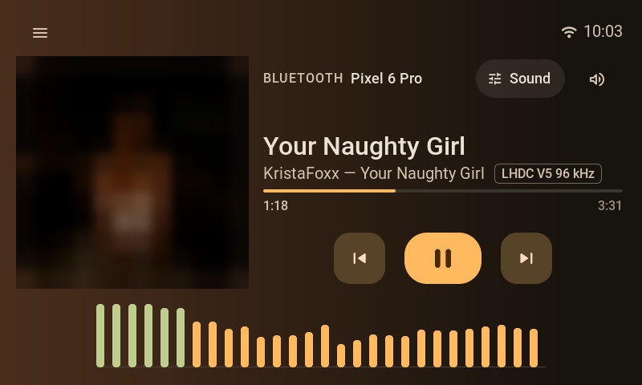</td>
<td>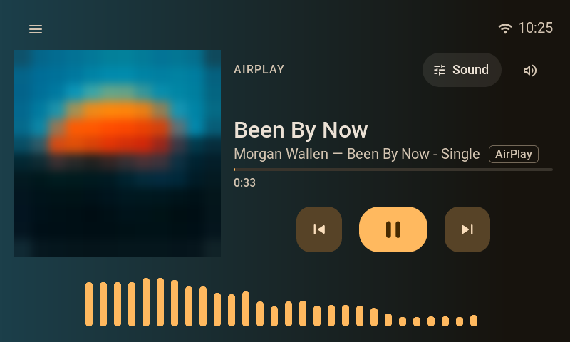</td>
</tr>
<tr>
<td>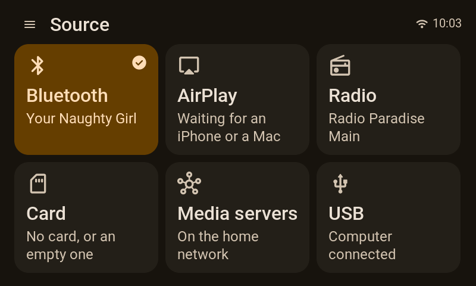</td>
<td>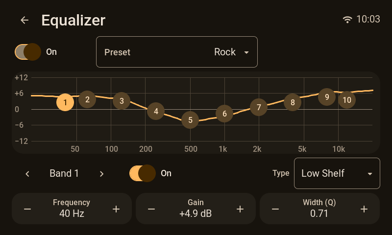</td>
</tr>
<tr>
<td>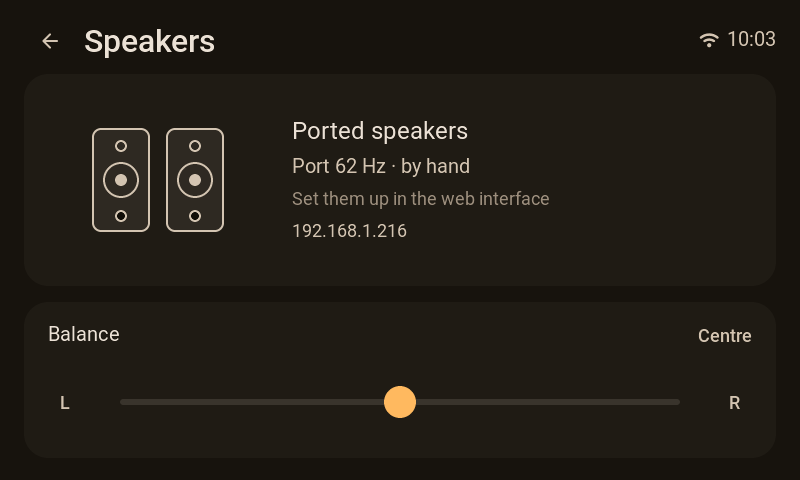</td>
<td>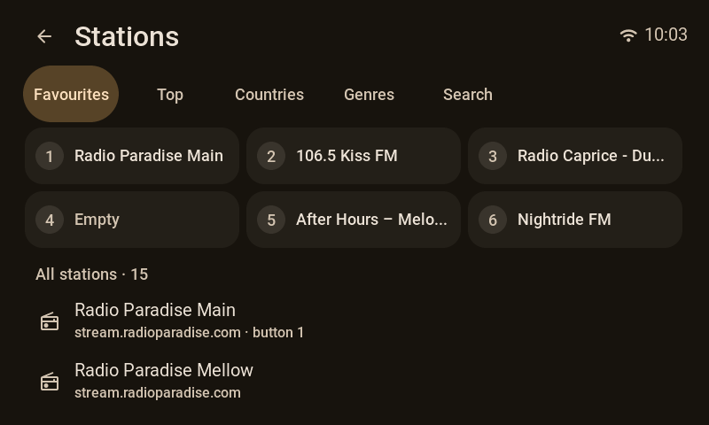</td>
</tr>
<tr>
<td>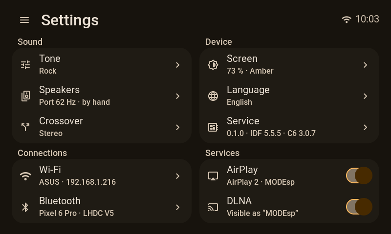</td>
<td>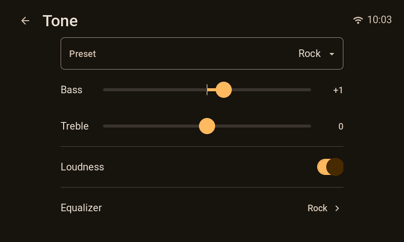</td>
</tr>
</table>

The web interface on a phone:

<table>
<tr>
<td>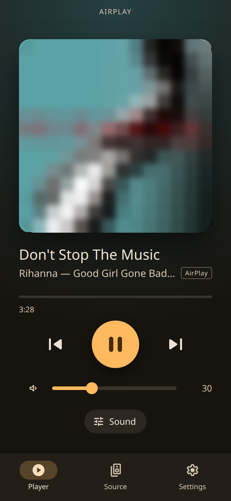</td>
<td>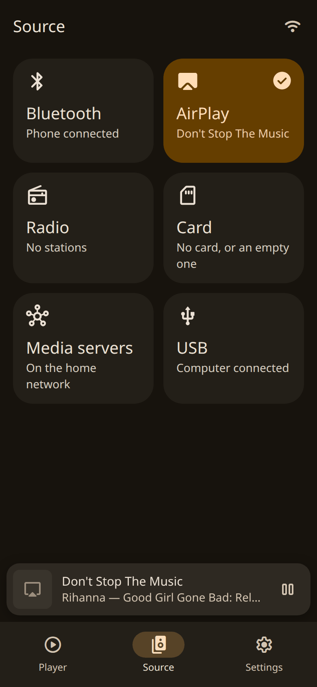</td>
<td>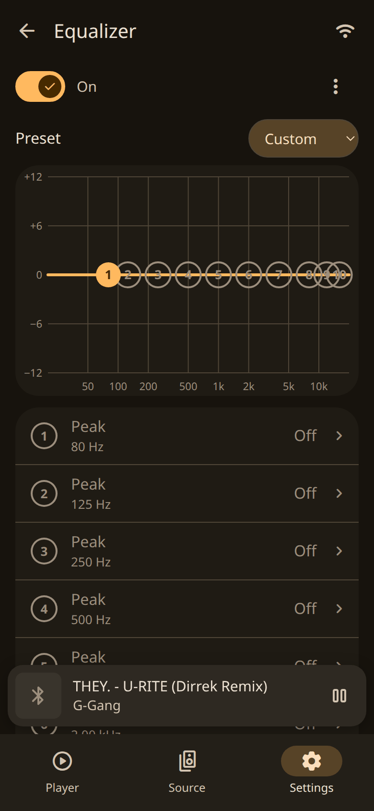</td>
</tr>
<tr>
<td>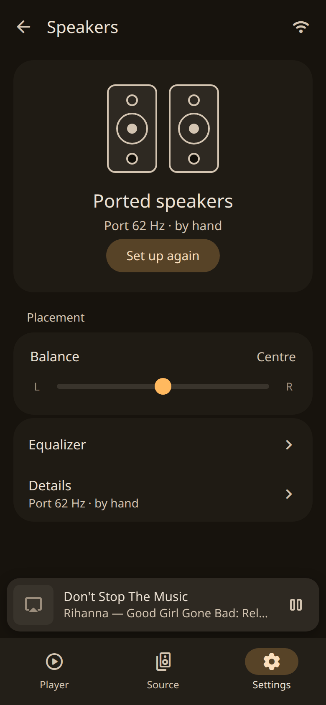</td>
<td>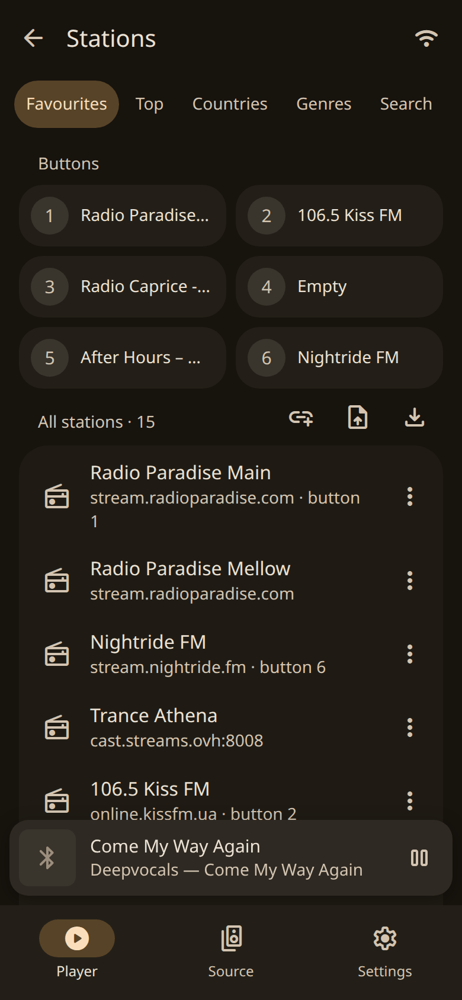</td>
<td>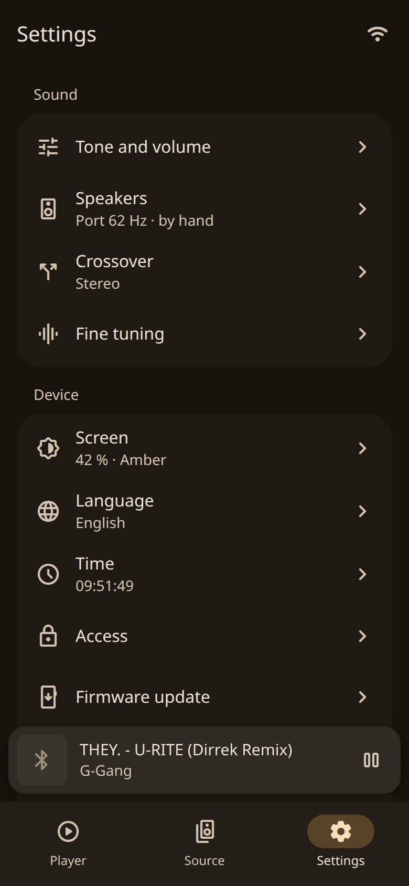</td>
</tr>
</table>

## Sources

| Source | What it does |
|---|---|
| Internet radio | Station catalogue from [Radio Browser](https://www.radio-browser.info) (country, genre, search), presets on the panel and in the web UI; MP3, AAC/HE-AAC and FLAC streams. The playing track's cover is looked up by its title ([docs/NETWORK.md](docs/NETWORK.md)) |
| DLNA / UPnP | Media renderer for Music Assistant, Home Assistant and other control points, and a browser for media servers on the panel ([docs/NETWORK.md](docs/NETWORK.md)) |
| AirPlay 2 | From an iPhone or a Mac; AirPlay 2, or a classic AirPlay 1 (RAOP) profile for senders without AirPlay 2, such as TuneBlade on Windows ([docs/NETWORK.md](docs/NETWORK.md)) |
| Bluetooth | Through a separate ESP32 satellite board over I2S and a UART link ([ModESP_BT_Satellite](https://github.com/Zapadenec1982/ModESP_BT_Satellite)): SBC, AAC, aptX, aptX HD; covers and track info over AVRCP ([docs/AUDIO.md](docs/AUDIO.md), [docs/LINK_PROTOCOL.md](docs/LINK_PROTOCOL.md)) |
| USB audio | A UAC2 sound card for a computer: 44.1 to 96 kHz, 16 or 24 bit, asynchronous with feedback, no driver needed on Windows 10 1703+, macOS or Linux ([docs/AUDIO.md](docs/AUDIO.md)) |
| microSD | FLAC, MP3, WAV and AAC/M4A from folders, with tags and embedded covers |

One source plays at a time. A phone or control point that starts playing over AirPlay or
DLNA takes the output at once; a computer that starts sending over USB takes over only when
the selected source is not playing; Bluetooth plays once it is picked as the source.

## Sound

- **The source's own sample rate, 44.1 to 96 kHz.** The output clock follows the source instead
  of converting everything to one rate. A file or stream outside that range is converted to
  the nearest rate of its own family (176.4 kHz plays at 88.2, 22.05 kHz at 44.1). When the
  Bluetooth satellite clocks the I2S link itself, the output clock is trimmed to follow it, or
  an adaptive resampler absorbs the drift where the clock cannot; when the satellite is an I2S
  slave, the P4 clocks the link and nothing is converted. The resampler is
  [dbry/audio-resampler](https://github.com/dbry/audio-resampler).
- **10-band parametric EQ** with ready-made sound presets and the user's own set; filters can
  be imported as REW or Equalizer APO text.
- **Loudness compensation** fitted to the ISO 226:2003 equal-loudness contours.
- **Subsonic filter** with bass-port protection, a **bass limiter** and a look-ahead
  **brickwall limiter** in front of the amplifier.
- **Spectrum display** on the panel.
- `eq.json` is sectioned for two outputs; the firmware drives one stereo DAC from the first
  section (output mode 2.0).

The DSP chain, the volume law and the limiters: [docs/AUDIO.md](docs/AUDIO.md).

## Control

- The panel: LVGL 9 touch UI, plus a rotary encoder with a button.
- A web UI served by the panel (Svelte): the player, stations, the microSD library, sound and
  DSP settings, and the device's system and service pages.
- Ukrainian, English, German and Polish, on the panel and on the web.
- MQTT with Home Assistant discovery is in the firmware and off by default. Home Assistant
  sees the player through DLNA and Music Assistant.

The panel and web UI: [docs/UI.md](docs/UI.md). The HTTP and WebSocket API, Wi-Fi and the
network sources: [docs/NETWORK.md](docs/NETWORK.md).

## Hardware

| Part | Role |
|---|---|
| Guition JC4880P443C | ESP32-P4 (2× RISC-V 360 MHz, 32 MB PSRAM, 16 MB flash) and ESP32-C6 (Wi-Fi 6) over SDIO with ESP-Hosted; 4.3" 480×800 IPS on ST7701S over MIPI-DSI; GT911 touch; microSD; USB HS and FS |
| PCM5102A | Stereo DAC on I2S; the P4 is the clock master, no MCLK |
| TPA3255 | Class-D amplifier |
| ESP32 Bluetooth satellite | A2DP sink with its own firmware: [Bluetooth satellite](#bluetooth-satellite) |
| Rotary encoder | Volume; its button plays and pauses, a hold opens the menu |

Pinout, signal path and the reasons behind them: [docs/CONCEPT.md](docs/CONCEPT.md) and
[docs/AUDIO.md](docs/AUDIO.md); the panel's display, touch and encoder:
[docs/PANEL.md](docs/PANEL.md). The board configuration is
[`boards/p4_player/board.json`](boards/p4_player/board.json).

Things worth knowing about this board:

- **The panel's ESP32-P4 is chip revision v1.3.** Components that require revision 3.0 do not
  run on it. `esp_audio_codec` is pinned below 2.6 for that reason.
- **Both USB ports' VBUS lines are tied together without a diode.** When the panel runs from its
  own 5 V supply, a computer plugged into the HS port is a second 5 V source on the same rail.
  Power the panel from that port, or put a Schottky diode in its VBUS line.
- **The C6 needs the ESP-Hosted slave firmware** from the same release as the host library
  (3.0.7): [docs/C6_UPDATE.md](docs/C6_UPDATE.md), `tools/c6_updater/`.

## Bluetooth satellite

Bluetooth audio comes from a second board, an original ESP32 with its own firmware:
**[ModESP_BT_Satellite](https://github.com/Zapadenec1982/ModESP_BT_Satellite)** (MIT licence).
Neither the ESP32-P4 nor the ESP32-C6 has Bluetooth Classic, and A2DP needs it. The satellite
receives the phone's stream, decodes it and hands the panel PCM over I2S; a UART link carries
everything else.


<table>
<tr>
<td></td>
<td>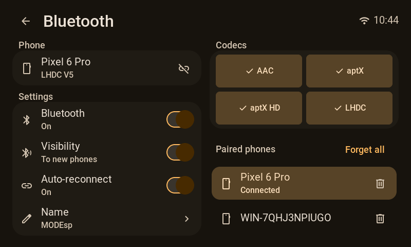</td>
<td>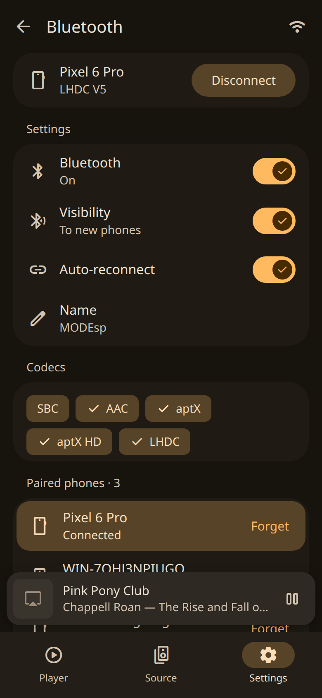</td>
</tr>
</table>

| Signal | Panel (ESP32-P4) | Satellite (ESP32-WROOM-32) |
|---|---|---|
| I2S BCLK | GPIO33 | GPIO13 |
| I2S WS | GPIO30 | GPIO26 |
| I2S DATA | GPIO31, in | GPIO27, out |
| UART, panel → satellite | GPIO26 TX (J5) | GPIO16 RX |
| UART, satellite → panel | GPIO27 RX (J5) | GPIO17 TX |
| Ground | GND (JP1) | GND |

- **Link:** UART 460,800 8N1, COBS frames with CRC-16, protocol 1.10:
  [docs/LINK_PROTOCOL.md](docs/LINK_PROTOCOL.md). The satellite keeps the same text word for word as
  its `docs/PROTOCOL.md`, and `tools/check_protocol_mirror.py` compares the copies.
- **Codecs:** SBC, AAC, aptX and aptX HD at 44.1 and 48 kHz; LHDC V5, up to 96 kHz, when the
  satellite is built with its decoder.
- **Clock:** a satellite of protocol 1.9 or later lets the panel clock the I2S line, so the input
  and the output run on one clock and nothing is resampled. An older satellite clocks the line
  itself.
- **What travels:** the title, artist, album, position and cover of the track; the play state;
  absolute volume both ways, so the phone's slider and the panel's volume move together;
  play, pause, next and previous from the panel; pairing confirmed on the panel's screen;
  Bluetooth settings and paired phones from the panel and the web interface.
- **In this repository:** `modules/bt` (the link, the `bt.*` keys, `/api/bt`) and
  `components/sat_link` (frames and messages, tested on the host). The audio side is
  [docs/AUDIO.md](docs/AUDIO.md), "Bluetooth via the satellite".
- **Building and flashing the satellite:** its
  [README](https://github.com/Zapadenec1982/ModESP_BT_Satellite#building).

## Building

ESP-IDF **v5.5.5**, target `esp32p4`.

```bash
git clone --recursive https://github.com/Zapadenec1982/ModESP_Streamer.git
cd ModESP_Streamer
. "$IDF_PATH/export.sh"                    # or the EIM activation script for v5.5.5
pip install -r tools/requirements.txt      # once, into the IDF Python environment
idf.py set-target esp32p4
idf.py build
idf.py -p <port> flash
```

- A full build needs a lot of memory. On a 16 GB machine `ninja -C build -j4` is safer than
  all cores at once.
- On Windows, point `IDF_COMPONENT_CACHE_PATH` at a short path: esp_hosted 3.0.7 does not
  unpack into the default cache (paths over 260 characters).
- The built web UI is committed in `data/www/`. To rebuild it: `cd webui && npm ci && npm run deploy`.

Host tests (pytest plus a C++ doctest runner; the C++ part needs `g++` and `cmake`):

```bash
python tools/run_host_tests.py
python tools/run_host_tests.py --no-cpp    # Python suite only
```

### Flash layout

There are two LittleFS partitions (`partitions_p4_16mb.csv`):

| Partition | Holds | `idf.py flash` |
|---|---|---|
| `data` at 0x430000 | `board.json`, `bindings.json`, `ui.json`, the web UI, the factory `eq.json` | rewritten from `data.bin` |
| `userdata` at 0xF80000 | the user's EQ and custom EQ, stations, the remote-device registry, the track to resume | never written |

`idf.py app-flash` writes only the application. A change to `board.json` reaches the panel
with a full `idf.py flash`, because it ships in `data.bin`. `board.json` and `bindings.json`
have to stay under 4096 bytes (`ConfigService::MAX_JSON_SIZE`); the build refuses a larger
one.

### On a running panel

- Logging ships at WARN. To open it up until the next reboot:
  `curl -u <user>:<password> -X POST http://<panel>/api/loglevel -d '{"tag":"*","level":"info"}'`
  (the HTTP API asks for Basic auth while it is enabled, which is the default).
- The console is the P4's USB-Serial/JTAG, and DTR is its reset line: `idf.py monitor` restarts
  the panel each time it attaches. To watch a running panel, open the port with DTR and RTS
  both cleared (on Linux in one `TIOCMBIC` call, before anything else touches the lines).

## Architecture

```
┌──────────────────────────────────────────────────────────────────────┐
│  PRODUCT MODULES                                                     │
│  ui_lvgl · audio (core, DSP) · player (microSD) · radio · dlna       │
│  airplay · bt (satellite link) · usb_audio · storage                 │
├──────────────────────────────────────────────────────────────────────┤
│  ModESP FRAMEWORK (control plane)                                    │
│  SharedState · PersistService · NVS · HAL · drivers                  │
│  Wi-Fi (ESP-Hosted → C6) · HTTP (REST) · WebSocket · MQTT · OTA      │
│  code generator (manifests → UI, headers, i18n) · Svelte web UI      │
├──────────────────────────────────────────────────────────────────────┤
│  ESP-IDF v5.5.5 · FreeRTOS · ESP32-P4                                │
└──────────────────────────────────────────────────────────────────────┘
```

The framework owns state and commands through SharedState; the web UI, the panel and MQTT all
read and write the same keys. The audio core is a task on core 1 that takes commands through a
FreeRTOS queue and hands back only slow status (meters, rates, counters): no sample crosses
the event bus. The file, radio, DLNA, AirPlay and USB sources share one PCM ring, owned by
one producer at a time. Bluetooth has a ring of its own: when the satellite is an I2S slave
the P4 clocks the link from its output port, otherwise the satellite clocks a separate I2S
input.

## Layout

```
main/                 app entry
components/           framework (modesp_core, modesp_services, modesp_hal, modesp_net,
                      modesp_mqtt), audio_dsp, audio_pipe, audio_resampler, airplay2,
                      esp_dlna, dlna_client, radio_catalog, cover, usb_uac, sat_link,
                      user_store, playlist, stations, …
modules/              product modules, selected in project.json
drivers/              dsi_st7701, gt911, i2s_std, rotary_encoder, sdmmc_card, uart_link, …
boards/p4_player/     board.json, bindings.json, sdkconfig.board
webui/                Svelte 4 web UI (built into data/www/)
tools/                code generator, font and icon builds, EQ fitting, host test runner
tools/c6_updater/     one-shot P4 image that flashes the ESP-Hosted firmware onto the C6
tools/sdio_soak/      SDIO soak test through the C6
tests/host/           C++ host tests (doctest)
docs/                 system, audio, network, UI and protocol references; procedures
```

Every document in `docs/` is in English and in Ukrainian (`*.uk.md`):

- [docs/CONCEPT.md](docs/CONCEPT.md): the system. Hardware, pinout, signal path and clocking,
  firmware architecture, hard constraints. Start here.
- [docs/AUDIO.md](docs/AUDIO.md): the audio core. Sample rates, the PCM ring, the DSP chain,
  volume and limiters, the Bluetooth and USB paths.
- [docs/NETWORK.md](docs/NETWORK.md): Wi-Fi through the C6, the HTTP and WebSocket API,
  internet radio, DLNA, AirPlay, MQTT.
- [docs/UI.md](docs/UI.md): the panel and web UI, languages, fonts and icons.
- [docs/LINK_PROTOCOL.md](docs/LINK_PROTOCOL.md): the byte-level link to the Bluetooth satellite.
- Procedures: [docs/PANEL.md](docs/PANEL.md) (panel bring-up),
  [docs/C6_UPDATE.md](docs/C6_UPDATE.md) (C6 firmware),
  [docs/MIC_CAPTURE.md](docs/MIC_CAPTURE.md) (capture from the onboard microphone),
  [docs/SOAK_TEST.md](docs/SOAK_TEST.md) (SDIO soak test).

## Upstream

The control plane is a fork of [ModESP_Framework](https://github.com/Zapadenec1982/ModESP_Framework),
a manifest-driven ESP32 framework (JSON manifests → code generator → firmware, web UI and MQTT
topics). Fixes it needed for the ESP32-P4 are kept separable for upstream.

## License

This project's own code is source-available under the
[PolyForm Noncommercial License 1.0.0](LICENSE).

Third-party code in this tree and in the built images keeps its own licence. Among it: the
AirPlay 2 receiver core in `components/airplay2/` (its author's non-commercial licence),
Espressif's components (Apache-2.0; ESPRESSIF MIT and Espressif Modified MIT, which allow use
with Espressif chips only), LVGL, TinyUSB, libsodium and littlefs. The inventory is
[THIRD_PARTY_NOTICES.md](THIRD_PARTY_NOTICES.md); the licence texts a binary release ships with
are in [THIRD_PARTY_LICENSES.txt](THIRD_PARTY_LICENSES.txt).
