[English](README.md) · **Українська**

# ModESP Streamer

Прошивка мережевого стереостримера з DSP на панелі **Guition JC4880P443C**
(ESP32-P4 з ESP32-C6 для Wi-Fi, сенсорний екран 4,3" 480×800). Грає інтернет-радіо, DLNA,
AirPlay 2, Bluetooth, USB-аудіо з комп'ютера і файли з microSD, пропускає їх через 32-бітний
float DSP-ланцюг і подає на зовнішній ЦАП і підсилювач класу D.

[](https://docs.espressif.com/projects/esp-idf/en/v5.5.5/esp32p4/)
[](https://isocpp.org/)
[](LICENSE)

Особистий проєкт: один пристрій, зроблений для однієї кімнати прослуховування, у щоденному
користуванні. Опублікований як довідка для тих, хто будує щось подібне на ESP32-P4. Це не
продукт, і підтримки до нього немає.

## Знімки екрана

Панель, 800×480:

<table>
<tr>
<td>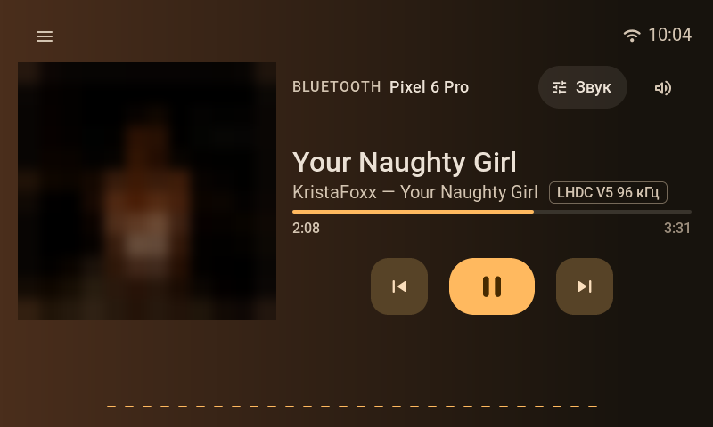</td>
<td>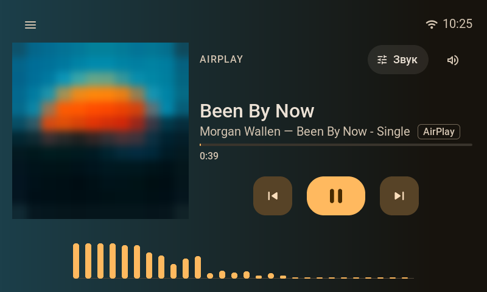</td>
</tr>
<tr>
<td>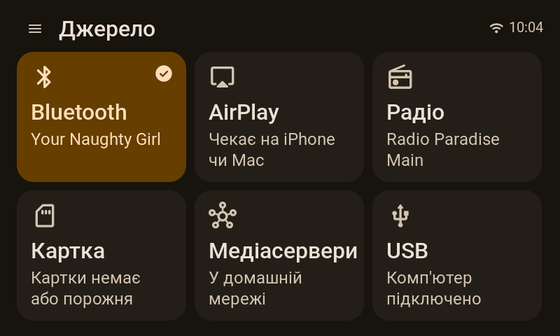</td>
<td>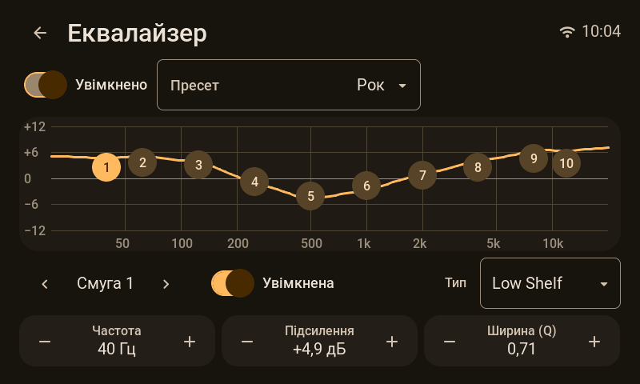</td>
</tr>
<tr>
<td>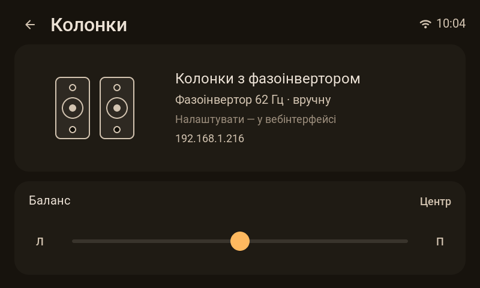</td>
<td>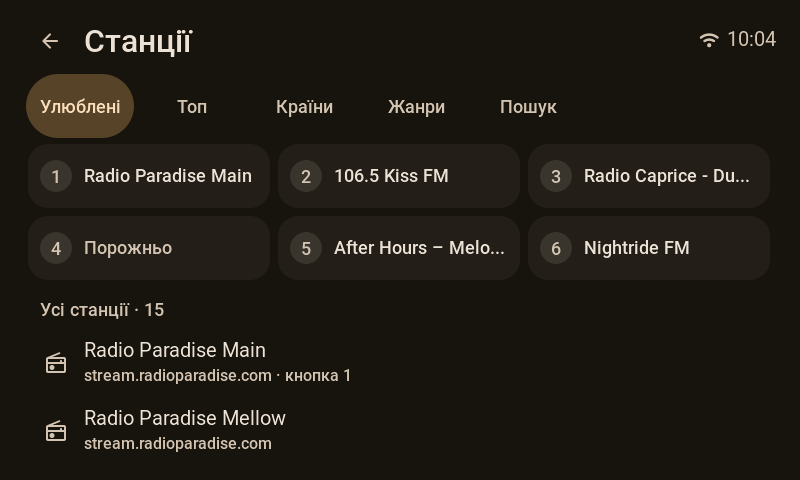</td>
</tr>
<tr>
<td>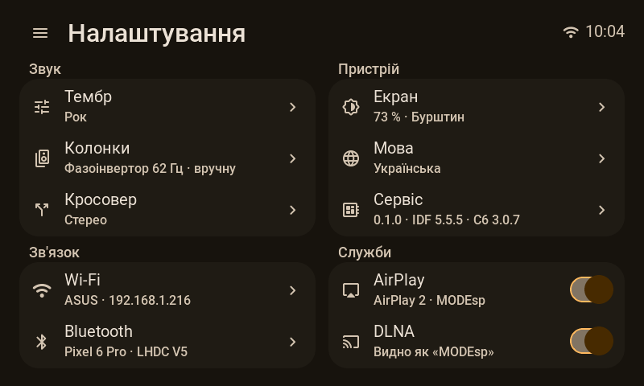</td>
<td>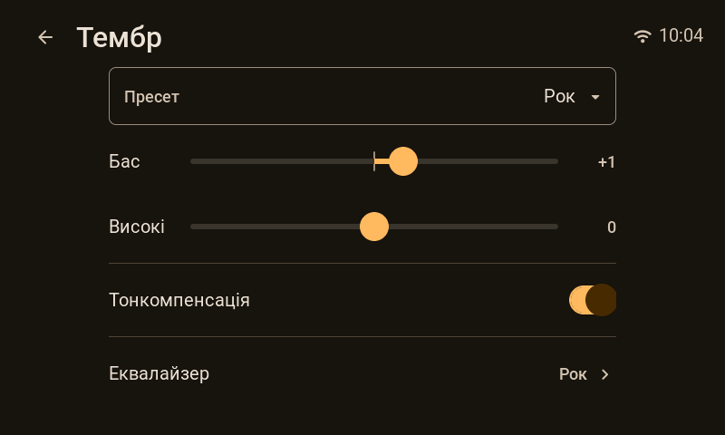</td>
</tr>
</table>

Вебінтерфейс на телефоні:

<table>
<tr>
<td>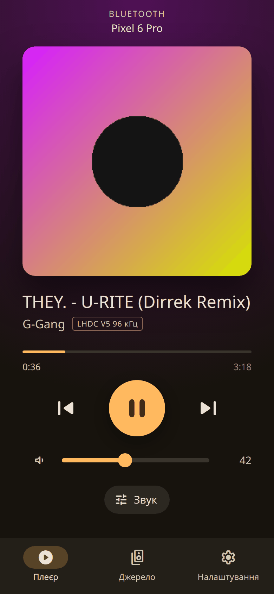</td>
<td>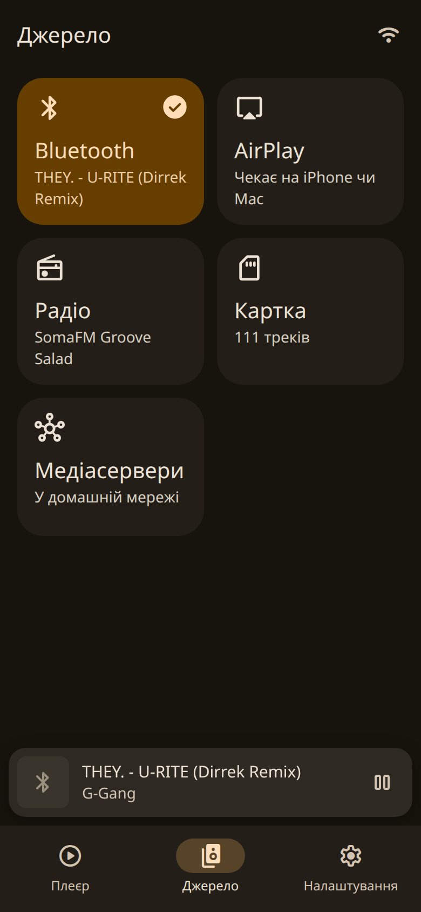</td>
<td>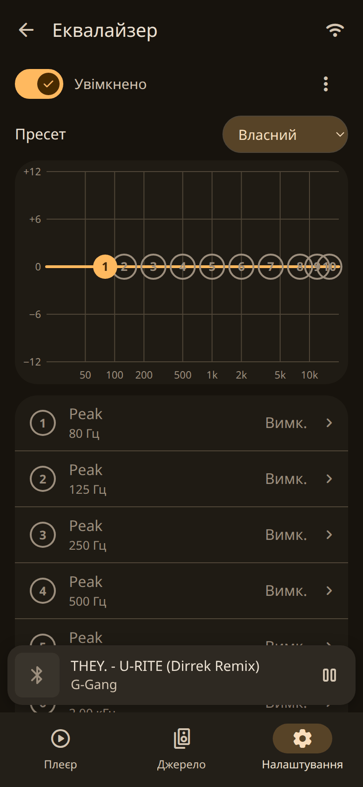</td>
</tr>
<tr>
<td>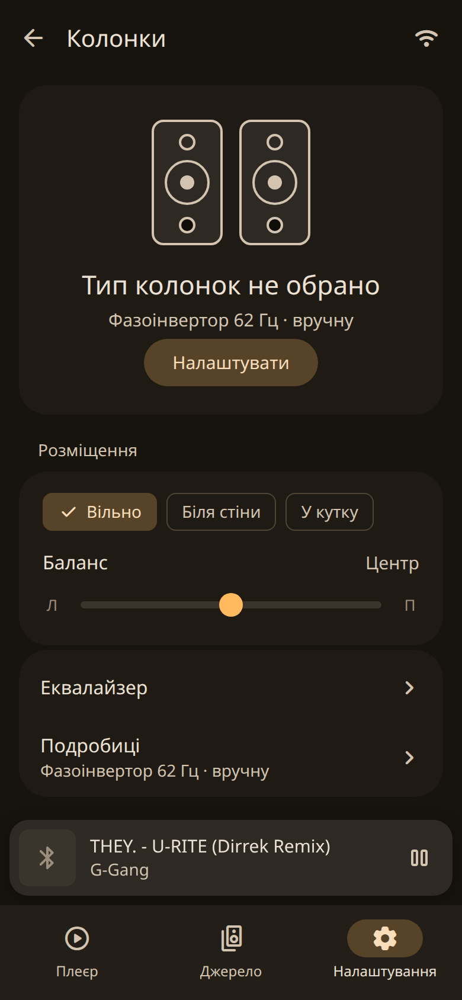</td>
<td>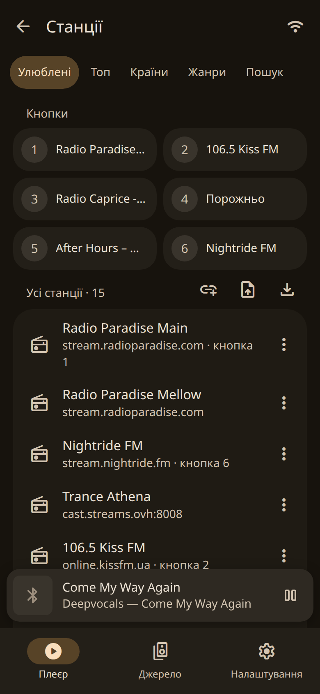</td>
<td>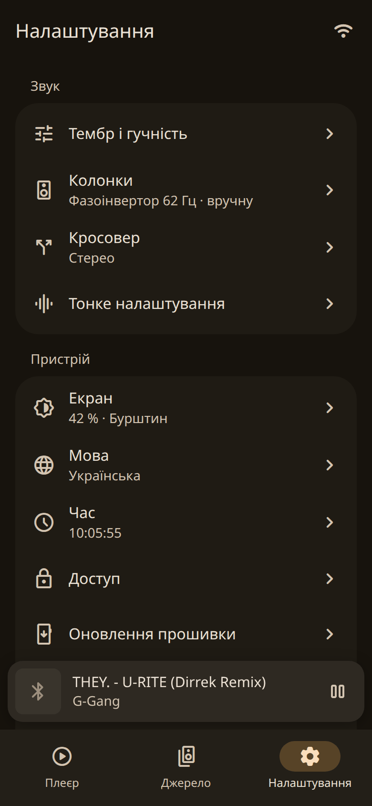</td>
</tr>
</table>

## Джерела

| Джерело | Що робить |
|---|---|
| Інтернет-радіо | Каталог станцій із [Radio Browser](https://www.radio-browser.info) (країна, жанр, пошук), пресети на панелі й у вебінтерфейсі; потоки MP3, AAC/HE-AAC і FLAC. Обкладинка поточного треку шукається за його назвою ([docs/NETWORK.uk.md](docs/NETWORK.uk.md)) |
| DLNA / UPnP | Медіарендерер для Music Assistant, Home Assistant та інших контрольних точок і браузер медіасерверів на панелі ([docs/NETWORK.uk.md](docs/NETWORK.uk.md)) |
| AirPlay 2 | З iPhone чи Mac; AirPlay 2 або класичний профіль AirPlay 1 (RAOP) для відправників без AirPlay 2, як-от TuneBlade у Windows ([docs/NETWORK.uk.md](docs/NETWORK.uk.md)) |
| Bluetooth | Через окрему плату-супутник ESP32 по I2S і UART-лінку ([ModESP_BT_Satellite](https://github.com/Zapadenec1982/ModESP_BT_Satellite)): SBC, AAC, aptX, aptX HD; обкладинки й дані треку по AVRCP ([docs/AUDIO.uk.md](docs/AUDIO.uk.md), [docs/LINK_PROTOCOL.uk.md](docs/LINK_PROTOCOL.uk.md)) |
| USB-аудіо | Звукова карта UAC2 для комп'ютера: від 44,1 до 96 кГц, 16 або 24 біти, асинхронна зі зворотним зв'язком, без драйвера у Windows 10 1703+, macOS чи Linux ([docs/AUDIO.uk.md](docs/AUDIO.uk.md)) |
| microSD | FLAC, MP3, WAV і AAC/M4A з папок, з тегами й вбудованими обкладинками |

Водночас грає одне джерело. Телефон або контрольна точка, що починає відтворення по AirPlay
чи DLNA, одразу забирає вихід; комп'ютер, що починає слати звук по USB, перебирає вихід лише
тоді, коли вибране джерело не грає; Bluetooth грає, коли його вибрано джерелом.

## Звук

- **Власна частота дискретизації джерела, від 44,1 до 96 кГц.** Вихідний такт іде за джерелом,
  а не все перетворюється до однієї частоти. Файл чи потік поза цим діапазоном перетворюється до
  найближчої частоти своєї родини (176,4 кГц грає на 88,2, 22,05 кГц — на 44,1). Коли
  BT-супутник сам тактує I2S-лінк, вихідний такт підстроюється під нього, а там, де такт цього
  не може, дрейф поглинає адаптивний ресемплер; коли супутник — I2S-раб, лінк тактує P4 і нічого
  не перетворюється. Ресемплер —
  [dbry/audio-resampler](https://github.com/dbry/audio-resampler).
- **10-смуговий параметричний еквалайзер** з готовими пресетами звуку й власним набором
  користувача; фільтри можна імпортувати як текст REW або Equalizer APO.
- **Тонкомпенсація**, підігнана під криві рівної гучності ISO 226:2003.
- **Сабсонік-фільтр** із захистом фазоінвертора, **бас-лімітер** і **брикволл-лімітер** із
  look-ahead перед підсилювачем.
- **Спектр** на панелі.
- `eq.json` поділений на секції для двох виходів; прошивка веде один стерео-ЦАП із першої
  секції (режим виходу 2.0).

DSP-ланцюг, закон гучності й лімітери: [docs/AUDIO.uk.md](docs/AUDIO.uk.md).

## Керування

- Панель: сенсорний інтерфейс на LVGL 9, а також поворотний енкодер із кнопкою.
- Вебінтерфейс, який віддає панель (Svelte): плеєр, станції, бібліотека microSD, налаштування
  звуку й DSP, системні й сервісні сторінки пристрою.
- Українська, англійська, німецька й польська — на панелі й у вебі.
- MQTT з discovery для Home Assistant є в прошивці й типово вимкнений. Home Assistant
  бачить плеєр через DLNA і Music Assistant.

Панель і вебінтерфейс: [docs/UI.uk.md](docs/UI.uk.md). HTTP і WebSocket API, Wi-Fi і
мережеві джерела: [docs/NETWORK.uk.md](docs/NETWORK.uk.md).

## Залізо

| Вузол | Роль |
|---|---|
| Guition JC4880P443C | ESP32-P4 (2× RISC-V 360 МГц, 32 МБ PSRAM, 16 МБ flash) і ESP32-C6 (Wi-Fi 6) на SDIO з ESP-Hosted; IPS 4,3" 480×800 на ST7701S по MIPI-DSI; тач GT911; microSD; USB HS і FS |
| PCM5102A | Стерео-ЦАП на I2S; P4 — майстер такту, без MCLK |
| TPA3255 | Підсилювач класу D |
| Bluetooth-супутник ESP32 | A2DP-приймач із власною прошивкою: [Bluetooth-супутник](#bluetooth-супутник) |
| Поворотний енкодер | Гучність; його кнопка вмикає відтворення й паузу, утримання відкриває меню |

Розпіновка, сигнальний шлях і причини, що за ними стоять: [docs/CONCEPT.uk.md](docs/CONCEPT.uk.md) і
[docs/AUDIO.uk.md](docs/AUDIO.uk.md); дисплей, тач і енкодер панелі:
[docs/PANEL.uk.md](docs/PANEL.uk.md). Конфігурація плати —
[`boards/p4_player/board.json`](boards/p4_player/board.json).

Що варто знати про цю плату:

- **ESP32-P4 на панелі — ревізії кристала v1.3.** Компоненти, яким потрібна ревізія 3.0, на
  ньому не працюють. Тому `esp_audio_codec` прибитий нижче 2.6.
- **Лінії VBUS обох USB-портів з'єднані без діода.** Коли панель живиться від власного
  джерела 5 В, комп'ютер, підключений до HS-порту, — друге джерело 5 В на тій самій шині.
  Живіть панель від цього порту або поставте діод Шотткі в його лінію VBUS.
- **C6 потрібна slave-прошивка ESP-Hosted** з того самого релізу, що й бібліотека хоста
  (3.0.7): [docs/C6_UPDATE.uk.md](docs/C6_UPDATE.uk.md), `tools/c6_updater/`.

## Bluetooth-супутник

Bluetooth-звук приходить з окремої плати — оригінального ESP32 з власною прошивкою:
**[ModESP_BT_Satellite](https://github.com/Zapadenec1982/ModESP_BT_Satellite)** (ліцензія MIT).
Ні ESP32-P4, ні ESP32-C6 не мають Bluetooth Classic, а A2DP без нього неможливий. Супутник приймає
потік з телефона, декодує його і віддає панелі PCM по I2S; усе інше йде UART-лінком.

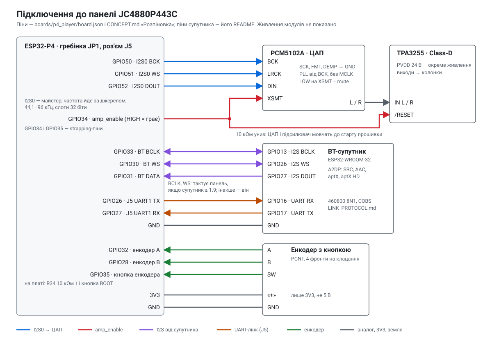

<table>
<tr>
<td></td>
<td>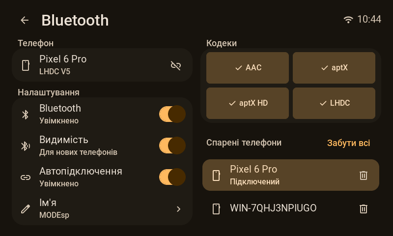</td>
<td>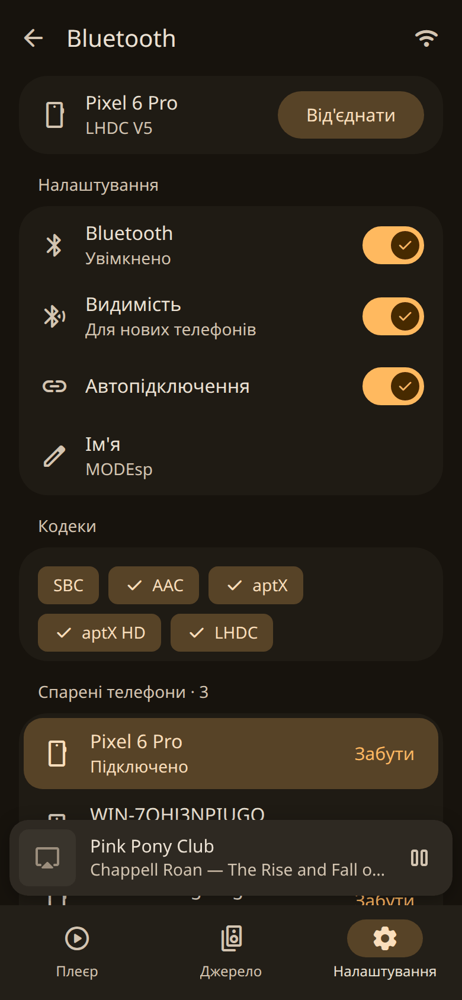</td>
</tr>
</table>

| Сигнал | Панель (ESP32-P4) | Супутник (ESP32-WROOM-32) |
|---|---|---|
| I2S BCLK | GPIO33 | GPIO13 |
| I2S WS | GPIO30 | GPIO26 |
| I2S DATA | GPIO31, вхід | GPIO27, вихід |
| UART, панель → супутник | GPIO26 TX (J5) | GPIO16 RX |
| UART, супутник → панель | GPIO27 RX (J5) | GPIO17 TX |
| Земля | GND (JP1) | GND |

- **Лінк:** UART 460 800 8N1, кадри COBS з CRC-16, протокол 1.10:
  [docs/LINK_PROTOCOL.uk.md](docs/LINK_PROTOCOL.uk.md). Супутник тримає той самий текст слово в слово
  як свій `docs/PROTOCOL.uk.md`, а `tools/check_protocol_mirror.py` звіряє копії.
- **Кодеки:** SBC, AAC, aptX і aptX HD на 44,1 і 48 кГц; LHDC V5, до 96 кГц, коли супутник
  зібрано з його декодером.
- **Тактування:** супутник з протоколом 1.9 і новіше дає панелі тактувати лінію I2S, тож вхід і вихід
  ідуть від одного такту і нічого не ресемплюється. Старіший супутник тактує лінію сам.
- **Що передається:** назва, виконавець, альбом, позиція й обкладинка треку; стан відтворення;
  абсолютна гучність в обидва боки, тож повзунок на телефоні й гучність панелі рухаються разом;
  відтворення, пауза, наступний і попередній трек з панелі; підтвердження спарювання на екрані
  панелі; налаштування Bluetooth і спарені телефони з панелі й вебінтерфейсу.
- **У цьому репозиторії:** `modules/bt` (лінк, ключі `bt.*`, `/api/bt`) і `components/sat_link`
  (кадри й повідомлення, тести на хості). Аудіобік —
  [docs/AUDIO.uk.md](docs/AUDIO.uk.md), «Bluetooth через супутник».
- **Збирання і прошивка супутника:** його
  [README](https://github.com/Zapadenec1982/ModESP_BT_Satellite/blob/main/README.uk.md).

## Збирання

ESP-IDF **v5.5.5**, ціль `esp32p4`.

```bash
git clone --recursive https://github.com/Zapadenec1982/ModESP_Streamer.git
cd ModESP_Streamer
. "$IDF_PATH/export.sh"                    # або скрипт активації EIM для v5.5.5
pip install -r tools/requirements.txt      # один раз, у Python-середовище IDF
idf.py set-target esp32p4
idf.py build
idf.py -p <port> flash
```

- Повне збирання потребує багато пам'яті. На машині з 16 ГБ `ninja -C build -j4` безпечніше,
  ніж усі ядра одразу.
- У Windows спрямуйте `IDF_COMPONENT_CACHE_PATH` на короткий шлях: esp_hosted 3.0.7 не
  розпаковується в типовий кеш (шляхи понад 260 символів).
- Зібраний вебінтерфейс закомічено в `data/www/`. Щоб перезібрати: `cd webui && npm ci && npm run deploy`.

Тести на хості (pytest плюс C++-раннер doctest; C++-частині потрібні `g++` і `cmake`):

```bash
python tools/run_host_tests.py
python tools/run_host_tests.py --no-cpp    # лише Python-набір
```

### Розкладка flash

Розділів LittleFS два (`partitions_p4_16mb.csv`):

| Розділ | Що містить | `idf.py flash` |
|---|---|---|
| `data` на 0x430000 | `board.json`, `bindings.json`, `ui.json`, вебінтерфейс, заводський `eq.json` | перезаписується з `data.bin` |
| `userdata` на 0xF80000 | EQ користувача і власний EQ, станції, реєстр віддалених пристроїв, трек для продовження | ніколи не записується |

`idf.py app-flash` пише лише застосунок. Зміна `board.json` доходить до панелі з повним
`idf.py flash`, бо він їде в `data.bin`. `board.json` і `bindings.json` мають лишатися меншими
за 4096 байтів (`ConfigService::MAX_JSON_SIZE`); більший файл збирання відкидає.

### На працюючій панелі

- Логування постачається на рівні WARN. Щоб відкрити його до наступного перезапуску:
  `curl -u <user>:<password> -X POST http://<panel>/api/loglevel -d '{"tag":"*","level":"info"}'`
  (HTTP API просить Basic auth, поки вона ввімкнена, а типово вона ввімкнена).
- Консоль — USB-Serial/JTAG самого P4, а DTR — його лінія скидання: `idf.py monitor`
  перезапускає панель щоразу, як підключається. Щоб спостерігати за працюючою панеллю,
  відкривайте порт зі скинутими і DTR, і RTS (у Linux — одним викликом `TIOCMBIC`, раніше, ніж
  щось інше торкнеться ліній).

## Архітектура

```
┌──────────────────────────────────────────────────────────────────────┐
│  МОДУЛІ ПРОДУКТУ                                                     │
│  ui_lvgl · audio (ядро, DSP) · player (microSD) · radio · dlna       │
│  airplay · bt (лінк із супутником) · usb_audio · storage             │
├──────────────────────────────────────────────────────────────────────┤
│  ФРЕЙМВОРК ModESP (площина керування)                                │
│  SharedState · PersistService · NVS · HAL · драйвери                 │
│  Wi-Fi (ESP-Hosted → C6) · HTTP (REST) · WebSocket · MQTT · OTA      │
│  генератор коду (маніфести → UI, заголовки, i18n) · веб-UI на Svelte │
├──────────────────────────────────────────────────────────────────────┤
│  ESP-IDF v5.5.5 · FreeRTOS · ESP32-P4                                │
└──────────────────────────────────────────────────────────────────────┘
```

Фреймворк володіє станом і командами через SharedState; вебінтерфейс, панель і MQTT читають
і пишуть ті самі ключі. Аудіоядро — задача на ядрі 1, яка приймає команди через чергу FreeRTOS
і повертає лише повільний статус (індикатори, частоти, лічильники): жоден семпл не йде шиною
подій. Файлове джерело, радіо, DLNA, AirPlay і USB ділять одне кільце PCM, яким у кожен момент
володіє один виробник. Bluetooth має власне кільце: коли супутник — I2S-раб, P4 тактує лінк
зі свого вихідного порту, інакше супутник тактує окремий вхід I2S.

## Структура

```
main/                 точка входу застосунку
components/           фреймворк (modesp_core, modesp_services, modesp_hal, modesp_net,
                      modesp_mqtt), audio_dsp, audio_pipe, audio_resampler, airplay2,
                      esp_dlna, dlna_client, radio_catalog, cover, usb_uac, sat_link,
                      user_store, playlist, stations, …
modules/              модулі продукту, вибрані в project.json
drivers/              dsi_st7701, gt911, i2s_std, rotary_encoder, sdmmc_card, uart_link, …
boards/p4_player/     board.json, bindings.json, sdkconfig.board
webui/                вебінтерфейс на Svelte 4 (збирається в data/www/)
tools/                генератор коду, збирання шрифтів та іконок, підгонка EQ, раннер тестів на хості
tools/c6_updater/     одноразовий образ P4, що прошиває ESP-Hosted на C6
tools/sdio_soak/      соук-тест SDIO через C6
tests/host/           C++-тести на хості (doctest)
docs/                 довідники системи, аудіо, мережі, UI і протоколу; процедури
```

Кожен документ у `docs/` є англійською й українською (`*.uk.md`):

- [docs/CONCEPT.uk.md](docs/CONCEPT.uk.md): система. Залізо, розпіновка, сигнальний шлях і
  тактування, архітектура прошивки, жорсткі обмеження. Почніть звідси.
- [docs/AUDIO.uk.md](docs/AUDIO.uk.md): аудіоядро. Частоти дискретизації, кільце PCM,
  DSP-ланцюг, гучність і лімітери, шляхи Bluetooth і USB.
- [docs/NETWORK.uk.md](docs/NETWORK.uk.md): Wi-Fi через C6, HTTP і WebSocket API,
  інтернет-радіо, DLNA, AirPlay, MQTT.
- [docs/UI.uk.md](docs/UI.uk.md): панель і вебінтерфейс, мови, шрифти й іконки.
- [docs/LINK_PROTOCOL.uk.md](docs/LINK_PROTOCOL.uk.md): байтовий лінк із Bluetooth-супутником.
- Процедури: [docs/PANEL.uk.md](docs/PANEL.uk.md) (запуск панелі),
  [docs/C6_UPDATE.uk.md](docs/C6_UPDATE.uk.md) (прошивка C6),
  [docs/MIC_CAPTURE.uk.md](docs/MIC_CAPTURE.uk.md) (запис із бортового мікрофона),
  [docs/SOAK_TEST.uk.md](docs/SOAK_TEST.uk.md) (соук-тест SDIO).

## Upstream

Площина керування — форк [ModESP_Framework](https://github.com/Zapadenec1982/ModESP_Framework),
ESP32-фреймворку, керованого маніфестами (JSON-маніфести → генератор коду → прошивка,
вебінтерфейс і теми MQTT). Виправлення, яких він потребував для ESP32-P4, тримаються
відокремлюваними для upstream.

## Ліцензія

Власний код цього проєкту відкритий для читання (source-available) за ліцензією
[PolyForm Noncommercial License 1.0.0](LICENSE).

Сторонній код у цьому дереві й у зібраних образах зберігає власну ліцензію. Серед нього: ядро
приймача AirPlay 2 у `components/airplay2/` (некомерційна ліцензія його автора), компоненти
Espressif (Apache-2.0; ESPRESSIF MIT і Espressif Modified MIT, які дозволяють використання лише
з кристалами Espressif), LVGL, TinyUSB, libsodium і littlefs. Перелік —
[THIRD_PARTY_NOTICES.uk.md](THIRD_PARTY_NOTICES.uk.md); тексти ліцензій, з якими постачається
бінарний реліз, — у [THIRD_PARTY_LICENSES.txt](THIRD_PARTY_LICENSES.txt).
