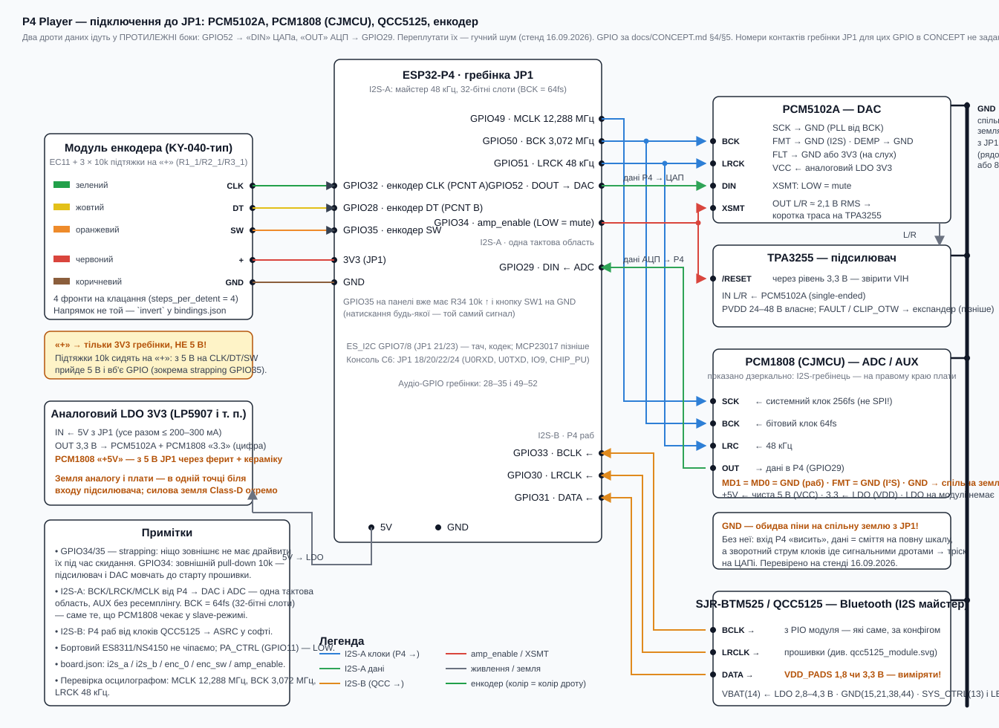
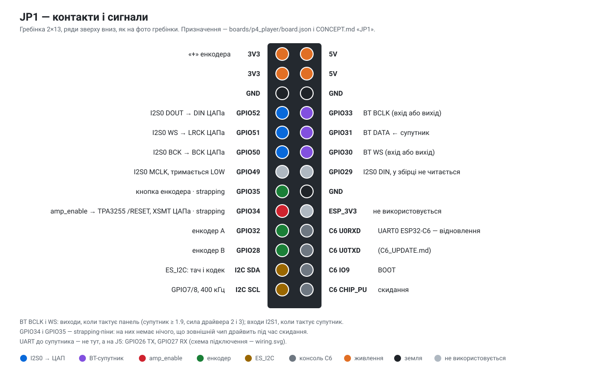
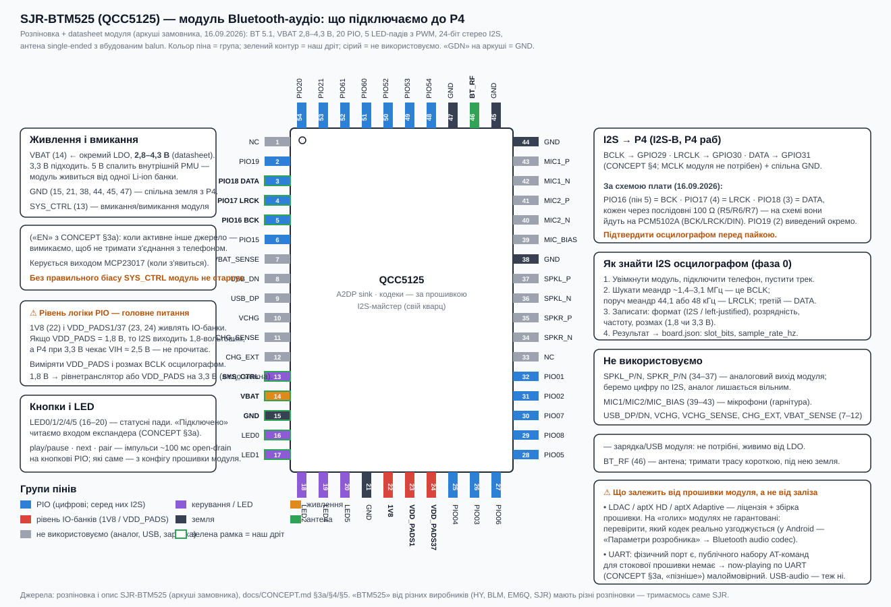

# Аудіоядро (етап 3, CONCEPT фаза 1)

Тракт (CONCEPT §3): джерело → [ASRC для BT] → гучність → сабсонік → PEQ → бас-лімітер → брикволл →
I2S-A TX → PCM5102A →
TPA3255. 48 кГц фіксовано, 32-бітні слоти I2S (24-бітні дані конвертерів), float усередині.
Керування — тільки через SharedState (`audio.*`), жоден семпл через шину не проходить.

## Схема підключення



`docs/img/wiring_jp1.svg` — DAC, ADC, BT-модуль, енкодер, amp_enable, LDO; GPIO за CONCEPT §4/§5.

### Реальна гребінка JP1 і пропозиція перегрупувати (16.09.2026)



Фото гребінки від замовника дало фізичне розташування (2×13, зверху вниз):

| Рядок | Ліворуч | Праворуч |
|---|---|---|
| 1–2 | 3V3, 3V3 | 5V, 5V |
| 3 | GND | GND |
| 4–7 | GPIO52, 51, 50, 49 | GPIO33, 31, 30, 29 |
| 8 | GPIO35 | GND |
| 9 | GPIO34 | ESP_3V3 |
| 10–11 | GPIO32, GPIO28 | C6_U0RXD, C6_U0TXD |
| 12–13 | I2C_SDA, I2C_SCL | C6_IO9, C6_CHIP_PU |

За призначенням із CONCEPT §4 сигнали одного джгута лежать по різних краях колодки: дані АЦП
(GPIO28) — за сім рядків від його ж клоків, а половинки енкодера (GPIO32 і GPIO33) — у різних
колонках. **Пропозиція — цикл із трьох пінів**, без нових вимог до заліза:

| Сигнал | Було | Стало | Чому |
|---|---|---|---|
| I2S-A DIN (АЦП OUT) | GPIO28 | **GPIO29** | навпроти MCLK — увесь I2S у рядках 4–7 |
| Енкодер DT | GPIO33 | **GPIO28** | поруч із CLK (GPIO32), рядки 10–11 |
| BT BCLK | GPIO29 | **GPIO33** | BT отримує три сусідні контакти 33/31/30 |

Решта без змін: DOUT 52, LRCK 51, BCK 50, MCLK 49, енкодер SW 35, amp_enable 34, BT LRCLK 30,
BT DATA 31. Strapping-піни (34/35) лишаються під mute і кнопкою, клоки на них не потрапляють —
як вимагає CONCEPT §4.

**Застосовано 16.09.2026** (рішення замовника): `boards/p4_player/board.json` і CONCEPT §4
оновлені. Коду зміна не стосується — піни живуть тільки в board.json; після прошивки новий
`data.bin` має потрапити на панель, інакше пристрій читатиме стару карту.

### Модуль енкодера (KY-040-тип, 5 пінів, фото 15.09.2026)

На платі три посадкових місця підтяжок R1_1 / R2_1 / R3_1 по 10k, підтягнуті на пін **«+»**,
а не на окреме живлення. Отже «+» — **тільки 3V3** гребінки: з 5 В підтяжки подадуть 5 В на
CLK/DT/SW і вб'ють GPIO (GPIO35 — ще й strapping).

| Пін модуля | Дріт (за фото) | JP1 / GPIO | Примітка |
|---|---|---|---|
| CLK | зелений | GPIO32 | PCNT A |
| DT | жовтий | GPIO33 | PCNT B |
| SW | оранжевий | GPIO35 | на панелі вже R34 10k ↑ + SW1 на GND → паралельно ≈ 5k, ок |
| + | червоний | **3V3** | живить підтяжки модуля |
| GND | коричневий | GND | |

Підтяжки модуля роблять фронти чистішими за внутрішні ~45k; внутрішні лишаємо увімкненими
(паралель не заважає). Напрямок обертання «не той» — `invert` у binding `enc_0`.
На фото читаються два резистори «103» (10k); третє місце перевірити тестером: CLK/DT/SW → «+»
має бути ≈ 10 кОм.

### Модуль PCM1808 (CJMCU) — за даташитом TI SLES177B

Шовкографія модуля: ліворуч `FMT` (надруковано як «FMY»), `MD1`, `MD0`, `GND`, `3.3`, `+5V`;
праворуч `BCK`, `OUT`, `LRC`, `SCK`, `GND`, `3.3V`; зверху `RIN`, `LIN`. LDO на платі немає —
обидві шини живлення треба подати ззовні.

| Пін модуля | Куди | Примітка (даташит) |
|---|---|---|
| SCK | GPIO49 | системний клок SCKI, 256 fs = **12,288 МГц** при 48 кГц (Table 1). Не SPI-clock |
| BCK | GPIO50 | 64 BCK/кадр = 3,072 МГц |
| LRC | GPIO51 | 48 кГц |
| OUT | GPIO29 | DOUT, вихід даних |
| MD1, MD0 | GND | Low+Low = **раб з автовизначенням 256/384/512 fs** |
| FMT («FMY») | GND | Low = **I²S 24 біт**; High = left-justified |
| GND | GND | обидва піни |
| **+5V** | **чиста шина 5 В** | VCC — аналогове живлення, 4,5–5,5 В (ном. 5) |
| **3.3** | **LDO 3,3 В** | VDD — цифрове живлення, 2,7–3,6 В (ном. 3,3) |
| RIN / LIN | лінійний вхід | full scale **3 Vp-p при VCC = 5 В** (≈ 1,06 В RMS) |

**Чотири речі, які варто знати перед пайкою:**

0. **Два дроти даних ідуть у протилежні боки.** GPIO52 (`DOUT` P4) → **`DIN` ЦАПа**, а
   `OUT` АЦП → **GPIO29** (`DIN` P4). Переплутати легко — обидва «дані», обидва між тими самими
   двома платами. Наслідок (стенд 16.09.2026): ЦАП отримує вихід АЦП замість нашого сигналу і
   дає гучний шум **незалежно від джерела** — навіть тест-тон, хоча в логах усе ідеально.
   Ознака: на гучності 8 % тон мав би бути ледь чутний (−66 дБFS), а в колонках гуркіт.
0б. **Земля — окремим дротом, обидва піни `GND`.** Знайдено на стенді 16.09.2026: без спільної
   землі вхід P4 «висить» відносно модуля і читає сміття на повну шкалу (`audio.in_l/in_r` =
   0,00 дБFS), а зворотний струм клоків шукає шлях сигнальними дротами — ЦАП отримує спотворені
   BCK/LRCK і в колонках стоїть тріск. Симптом виглядає як «АЦП не працює», хоча всі сигнальні
   дроти правильні. На схемі земля тепер намальована окремою шиною, а не рядком у таблиці.
1. **Живлення — обидві шини.** VCC (аналог) = 5 В, VDD (цифра) = 3,3 В; на модулі LDO немає,
   тому подати обидві. *Раніше в цьому файлі було «+5V не підключати» — це помилка, виправлено.*
   План: 5 В з JP1 через фільтр (ферит + кераміка) на `+5V`, і з тієї ж 5 В малошумний LDO
   3,3 В на `3.3` і на PCM5102A.
2. **Слот 32 біти — обов'язковий.** У slave-режимі PCM1808 приймає 64 BCK/кадр або 48
   (лише при 384 fs), **але не 32**. Наші 32-бітні слоти дають рівно 64 — збігається; з
   16-бітними слотами АЦП просто не працюватиме. Тобто `slot_bits: 32` у `i2s_a` — не
   уподобання, а вимога чіпа.
3. **Рівні сходяться без трансляторів.** MD0/MD1/FMT/SCKI — Schmitt-тригери, 5-В толерантні,
   з внутрішніми притяжками 50 кОм (тобто без дротів вони й так дають slave + I²S; на GND
   тягнемо для завадостійкості). VIH = 2 В, так що 3,3 В від P4 достатньо; DOUT іде від
   VDD 3,3 В — P4 читає прямо.

**Розбіжність із CONCEPT §5 — на твоє рішення.** CONCEPT каже «Вхід 0,6 В RMS full-scale — на
лінійний сигнал потрібен дільник або буфер». Даташит дає **3 Vp-p ≈ 1,06 В RMS**. Побутовий
лінійний рівень (−10 dBV ≈ 0,32 В RMS ≈ 0,9 Vp-p) сидить приблизно на −10 дБFS — дільник тут
не потрібен, він лише додатково послабить сигнал. Студійний +4 dBu (≈ 3,5 Vp-p) справді трохи
клiпуватиме. Пропоную: **дільник не ставити**, перевірити реальним джерелом по `audio.level_l/r`
і ділити вже за фактом.

⚠️ Сторінка cirkitdesigner про PCM1808 — ненадійна: вона називає MD1/MD0 «FMT0/FMT1», вигадує
пін PDWN на 14-му місці (там VINR) і дає діапазон входу «0,6–2,1 Vpp». Джерело — даташит TI.

### Bluetooth — відкладено (рішення замовника 16.09.2026)

BT-джерело чекає на **керовану** плату: у SJR-BTM525 немає публічних AT-команд, а керувати
відтворенням треба (CONCEPT §3а). Тому `i2s_b` **розв'язано** — рядка в `bindings.json` немає,
запис пінів у `board.json` лишається як документація.

Що це дає зараз: slave-порт I2S не створюється → повертається ≈23 КБ DMA-SRAM (кільце RX
6 × 10 мс) і звільняється APLL; `audio.sources` більше не має біта BT, тому клавіша «BT» на
екрані сіра й не натискається, а збережене джерело = BT при старті відкочується в OFF.

Повернути, коли прийде плата, — один рядок:

```json
{"hardware": "i2s_b", "driver": "i2s_std", "role": "port_bt", "module": "audio"}
```

Код ASRC, кільця і джерела `SRC_BT` лишається на місці — його нічого не чіпає.

**Плата, яку замовник уже купив** (схема 16.09.2026: BTM525 + PCM5102A + USB-C із зарядкою +
LED): керувати відтворенням із неї не вийде (немає AT-команд), але вона дає два запасні шляхи,
якщо з «правильною» платою будуть затримки:

- **Цифровий:** зняти I2S до DAC — PIO16/17/18 (через ті самі R5/R6/R7) на GPIO29/30/31.
  Якість без втрат, але керування все одно лишається кнопками модуля.
- **Аналоговий:** лінійний вихід її PCM5102A → вхід нашого PCM1808 (джерело AUX).
  Нуль роботи по цифрі, але зайва пара перетворень ЦАП→АЦП і окремий вхід зайнятий.

Побічна можливість, поки APLL вільний: перевести I2S-A майстер з XTAL на APLL (зараз
12,288 МГц синтезується дробовим дільником від 40 МГц XTAL — це джитер на SCKI ADC).
Один рядок у `drivers/i2s_std/src/i2s_std_driver.cpp`; робити після того, як тон і AUX
зазвучать, і не забути, що BT-раб теж потребує APLL — тоді вибирати, кому він потрібніший.

### Модуль SJR-BTM525 / QCC5125 (Bluetooth, аркуші 16.09.2026) — коли повернемось



54 піни, нумерація проти годинникової від лівого верхнього кута. Що нам треба:

| Пін(и) | Сигнал | Куди |
|---|---|---|
| ? (PIO — за конфігом прошивки) | BCLK / LRCLK / DATA | GPIO29 / GPIO30 / GPIO31 |
| 15, 21, 38, 44, 45, 47 | GND | спільна земля з P4 |
| 14 | VBAT | окремий LDO, **2,8–4,3 В** (datasheet SJR-BTM525); 3,3 В підходить, 5 В спалить внутрішній PMU |
| 13 | SYS_CTRL | вмикання/вимикання модуля («EN» з CONCEPT §3а) — вихід MCP23017 |
| 16–20 | LED0/1/2/4/5 | «підключено» → вхід експандера |
| 46 | BT_RF | антена (коротка траса, земля під нею) |

Не чіпаємо: SPKL/SPKR (34–37) — аналоговий вихід модуля, ми беремо цифру; MIC1/MIC2/MIC_BIAS
(39–43); USB_DP/DN, VCHG, VCHG_SENSE, CHG_EXT, VBAT_SENSE (7–12) — зарядка модуля.

Модуль — гола SMD-плата 13 × 18 × 2,8 мм: живлення, RF-траса (антена 2,4 ГГц на BT_RF, на
платі є balun і Tx/Rx-switch) і вихідний каскад — на нашій носійній платі. Підсилювача на
модулі немає, тому шлях «I2S → PCM5102A → TPA3255» з CONCEPT §3 лишається.

**Два питання, які аркуш не закриває** (обидва — на осцилограф у фазі 0, CONCEPT §10):

1. ~~Які саме PIO віддають I2S~~ — **знайдено зі схеми** (16.09.2026):

   | PIO | Пін | Сигнал | На схемі |
   |---|---|---|---|
   | PIO16 | 5 | BCK | через R7 100 Ω → PCM5102A BCK |
   | PIO17 | 4 | LRCK | через R5 100 Ω → PCM5102A LRCK |
   | PIO18 | 3 | DATA | через R6 100 Ω → PCM5102A DIN |

   PIO19 (пін 2) виведений окремо — призначення невідоме. Послідовні 100 Ω — гасіння дзвону
   на фронтах; на нашій носійній платі зробити так само.
   Все одно підтвердити осцилографом перед пайкою (схема ≠ прошивка, яка реально залита).

2. **Рівень логіки** — лишається відкритим. Піни 22 (`1V8`) і 23/24 (`VDD_PADS1`, `VDD_PADS37`)
   живлять IO-банки. Якщо VDD_PADS = 1,8 В, I2S виходить 1,8-вольтовим, а P4 при 3,3 В чекає
   VIH ≈ 2,5 В — не прочитає. **Непряма ознака:** на схемі ці ж лінії йдуть прямо на PCM5102A,
   якому при 3,3 В треба VIH ≈ 2,3 В; якщо плата працює — рівень швидше за все 3,3 В.
   Це висновок, не факт: виміряти VDD_PADS і розмах BCK.

Результат → `board.json` секція `i2s_b`: `slot_bits` (16/32) і `sample_rate_hz` (44100/48000);
формат I2S чи left-justified. Коду це не міняє.

Кнопки play/pause · next · pair — імпульси ~100 мс open-drain на кнопкові PIO; які саме,
теж з конфігу модуля (CONCEPT §3а).

**Що залежить від прошивки модуля, а не від заліза** (з опису SJR-BTM525):

- **LDAC / aptX HD / aptX Adaptive не гарантовані** на голому модулі — вони потребують ліцензії
  Qualcomm і відповідної збірки прошивки. CONCEPT §2/§3а записує їх як даність — перевірити на
  стенді: підключити телефон і подивитись, який кодек узгодився (Android: «Параметри розробника» →
  Bluetooth audio codec). Якщо там лише SBC/AAC — **це рішення замовника**: жити з SBC/AAC,
  шукати модуль із підтвердженою ліцензією, чи міняти джерело BT.
- **Публічного набору AT-команд для стокової прошивки немає.** Отже now-playing по UART
  (CONCEPT §3а, «пізніше можливо») майже напевно не вийде — керування лишається імпульсами на
  кнопкові PIO через експандер, а метадані BT на екрані не показуємо.
- USB-audio (UAC) стоково не працює — для нас неважливо, USB модуля не використовуємо.
- «BTM525» від різних виробників (HY, BLM, EM6Q, SJR) мають **різні розпіновки** — тримаємось
  саме аркуша SJR.

## Залізо → board.json → драйвер → модуль

| Секція | Запис | Драйвер | Роль у `audio` |
|---|---|---|---|
| `i2s_buses` | `i2s_a`: port 0, майстер, MCLK 49 (PCM1808 SCKI 256fs), BCLK 50, WS 51, DOUT 52 → PCM5102A, DIN 29 ← PCM1808 | `i2s_std` (full-duplex, одна тактова область) | `port_main` |
| `i2s_buses` | `i2s_b`: port 1, раб, BCLK 33, WS 30, DIN 31 ← BT | `i2s_std` (RX) | `port_bt` — **не прив'язано** (див. вище) |
| `gpio_outputs` | `amp_enable`: GPIO34, HIGH = грає (TPA3255 /RESET + PCM5102A XSMT), HAL тримає LOW до старту | `gpio_output` | `amp_enable` (опц.) |

Піни — CONCEPT §4; формат/fs QCC5125 — відкрите питання §11: `slot_bits` і `sample_rate_hz` в
`i2s_b` міняються без правки коду, реальна частота вимірюється (`audio.in_rate`).

Шов: `modesp/hal/audio_sink.h` — `IAudioSink::as_port()` → `IAudioPort` (stereo int32,
`read`/`write`, DMA-темп). Реєстр `audio` без змін.

## Модуль `audio`

- Задача `audio` на ядрі 1 (пріоритет 18, стек 8 КБ у internal SRAM), блок 240 кадрів = 5 мс.
  TX DMA-кільце 10 × 10 мс (перекриває стоп кешу при стиранні flash), RX 6 × 10 мс.
- Джерела: `audio.source` = 0 off / 1 тест-тон (−12 дБFS, `audio.tone_hz`) / 2 AUX (I2S-A RX,
  без ресемплінгу — той самий клок) / 3 BT (I2S-B RX → PSRAM-кільце 1 с → ASRC).
- Вихідний клок іде за джерелом: продюсер (`player`/`radio`) просить частоту через
  `PcmRing::ask_rate`, консумер відповідає `set_out_rate` після ретюну I2S. Зміна частоти між
  треками (етап 9, F1): `player` перед `ask_rate` чекає, поки хвіст попереднього треку в кільці
  дограється (`eos`, `available()==0`; обмежено 1,5 с, далі flush), а консумер не ретюнить,
  поки в кільці є кадри старої частоти і немає flush (`PcmRing::rate_change_due`) — інакше
  ~450 мс хвоста грали на новому клоці (44,1→48 = +8,8 %). Треки однієї частоти лишаються
  безпаузними. Частоту, яку порт відмовився взяти, `retune()` пробує один раз замінити базовою
  частотою її родини (`fallback_rate`: 44,1/48 кГц), далі клок лишається де є і продюсер
  конвертує в нього; рекурсії немає.
- ASRC (BT): `components/audio_resampler` (dbry, BSD-3), 48 × 48-tap sinc, LP 0,98 Найквіста
  джерела, ratio = вихідний клок / оголошена частота потоку (виміряна — доки немає
  `STREAM_FMT`), підправляється заповненням кільця. Ціль — **120 мс** у кадрах поточної частоти
  BT (`BT_TARGET_MS`; було 50 % односекундного кільця = 500 мс латентності телефон→колонка);
  авторитет ±500 ppm у смузі ±40 мс від цілі, плавно до ±2 % при відхиленні ≥ 100 мс; хвіст
  переставляється один раз при черзі > 500 мс (`BT_RESYNC_MS`). Кільце як і раніше 1 с @ 48 кГц,
  без переалокації. Пре-буфер до цілі, при спорожненні — тиша і повторний пре-буфер
  (`audio.underruns`). Лог `BT signal` показує чергу і в %, і в мс.
- DSP v2 (з 02.10.2026, `docs/DSP_V2_DESIGN_2026-09-30.md`), порядок у `DspChain::process`:
  вхідне підсилення → сабсонік (з підйомом порту) → тонкомпенсація → Бас і Високі → PEQ →
  ширина/моно-бас → баланс → бас-лімітер → брикволл.
  Усередині ланцюга **1,0 = стеля підсилювача**, не повна шкала ЦАП: вихідне перетворення множить
  на `k_out = 10^(T/20)`, T = min(C − 0,5, −1) dBFS, C — `audio.amp_clip_db10` (типово −9,8 dBFS:
  TPA3255 при 24 В, SLASEA8A §7.5; точно — калібруванням, `docs/DSP_V2_CALIBRATION.md`).
- Вхідне підсилення: трим (`gain_db` секції eq.json, −24…+12 дБ) · гучність · запас під EQ, одна
  двополюсна рампа (5 мс, mute/unmute 10 мс). Гучність 1 % = −80 дБ … 100 % = `audio.drive_db`
  (0…6 дБ, типово 0): повна шкала джерела на 100 % — рівно стеля. Від 50 % і вище — 0,6 дБ на
  крок, як і до 14.10.2026; нижче кроки ростуть до ~1,4 дБ (`DspChain::volume_db`), бо старий низ
  (1 % = −59,4 дБ) зблизька в тиші був загучним. Колишні 1 % тепер ≈ 17 %. Запас B — найгучніша точка
  сумарної АЧХ EQ (з тримом, шириною понад 1 і сабсоніком) на 20 Гц…min(20 кГц, 0,49 fs); гучність
  зупиняється на drive − B, тобто верх шкали плаский, а нижче EQ on/off відрізняється лише смугами
  (`audio.eq_headroom_db`). З бас-лімітером B на кожній частоті рахує лише те, чого він там не
  забирає (LR4-частки й правило змішування з `bass_knot`): підйом басу, який він поглинає, гучність
  не знижує, а підйом поза його досяжністю (150 Гц при xo 120) рахується повністю.
- Найгучніше й після увімкнення (з 14.10.2026, `docs/PLAN_SOUND_UX_2026-10-14.md` S4):
  `audio.vol_max` (40…100 %, типово 100) стискає шкалу, а не обрізає: грає `audio.volume ×
  vol_max / 100` того самого закону, тож 100 % з будь-якого клієнта — це межа, а крок дрібнішає
  (0,51 дБ при 85 %). Збережену гучність ніхто не виправляє — ехо-петлям з AirPlay, Bluetooth і
  DLNA нізвідки взятися. Тонкомпенсація рахується від рівня, що грає. Після увімкнення гучність
  не більша за `audio.vol_start` (0 — як була): сама збережена гучність опускається, тож усі
  клієнти показують те, що грає; `/api/restore` зберігає й перезапускає, тож теж сюди. Утриману
  (retained) команду MQTT брокер повторює при кожному підключенні — її не виконуємо.
- Гучність і межа йдуть до аудіо-задачі не чергою команд, яка відкидала те, що не влізло
  (загублена гучність лишалась загубленою до наступної зміни), а регістром останнього значення
  (`LevelLatch`, `level_latch.h`): задача читає його щоблоку. `audio.vol_eff` — рівень, який вона
  вже застосувала.
- Сабсонік: Баттерворт 4-го порядку, `audio.hp_hz` (0 — вимк., 20…80, типово 40). Поки задано
  частоту порту колонок `audio.port_hz` (30…80; 0 — вимк.), сабсонік стоїть на 0,8 від неї, а на
  ній самій — пік `audio.port_lift_db` (0…6 дБ, типово 3, Q 1,4): підйом там, де дифузор
  фазоінвертора майже не рухається (працює порт), і захист нижче. Пік рахується в запасі B (з
  бас-лімітером — лише та частка, яку він не поглинає). Частоту порту панель міряє сама бортовим
  мікрофоном (`audio.port_meas`, ~45 с): мікрофон біля центру дифузора, розгортка тонів 20…100 Гц
  повз DSP, провал у ближньому полі = частота порту (Keele, 1974); впевнений результат сам
  записується в `audio.port_hz`. Процедура — `docs/DSP_V2_CALIBRATION.md`, як працює — дизайн §12.4.
- Тонкомпенсація: `audio.loudness` (0…100 %, типово 70; 0 — вимк.). Дві полиці RBJ, 149 Гц
  (Q 0,359) і 10 кГц (Q 0,71), підігнані до ISO 226:2003 відносно 85 фон на верху шкали гучності
  (`tools/eq/fit_loudness.py`): на a дБ нижче верху (верх = drive − B, тож з підйомом EQ він
  опускається разом із ним) басова полиця дає 0,5605·a дБ, верхня 0,2253·a дБ, × сила; a ≤ 50.
  Від контурів (відносно 1 кГц) — до 1,1 дБ при a ≤ 30, 1,8 дБ при 50. Полиці завжди піднімають
  менше, ніж забрала гучність, тож понад те, що грає 100 %, не виходить нічого; на верху шкали й
  вимкнена — точний «дріт». Коефіцієнти ковзають за гучністю (τ 50 мс, лінійна інтерполяція
  всередині блоку — без тиків при обертанні ручки). Поточний підйом басу — `audio.loud_db`.
- Бас і Високі (з 14.10.2026, `docs/PLAN_SOUND_UX_2026-10-14.md` S3): `audio.bass_db` і
  `audio.treble_db`, −6…+6 дБ. Дві власні секції SVF — низька полиця на 100 Гц і висока на 10 кГц,
  Q 0,71 (кути — під перевірку на слух) — одразу після тонкомпенсації; жодної з десяти смуг PEQ
  не займають і діють і тоді, коли PEQ вимкнено. Рахуються в запасі B; зміна — тим самим
  перехресним переходом 20 мс, що й правка смуги; на 0 дБ — точний «дріт».
- Баланс: `audio.balance_db10`, −60…+60 (десяті дБ): більше нуля — тихіше лівий канал, менше —
  правий; лише послаблює, тож запасу не бере. Після ширини, перед бас-лімітером, ковзає як
  гучність; на 0 — точний «дріт».
- PEQ: до 10 смуг, кожна — одна секція трапецієвидного SVF (Simper) на обидва канали
  (`dsp_kernels.cpp`, явні `fmaf`, `-ffp-contract=off`). Не DF2-біквад: той у float32 на низькій
  смузі й високій частоті давав шум −36 дБ відносно сигналу на 96 кГц (дослідження 30.09); SVF —
  −127. Дизайн у double: піки, полиці, режекція — matched (Vicanek), АЧХ = аналоговий прототип
  RBJ на DC, Найквісті й f0, тож EQ однаковий на 44,1…192 кГц; ФНЧ/ФВЧ — білінійні. Q полиць
  ≤ 1,0. Конфіг `eq.json` (`type`, `f`, `gain`, `q`, `on`), перечитати — `audio.eq_reload`; обхід —
  `audio.eq_enabled`. Будь-яка зміна смуги кросфейдиться 20 мс (старий дизайн — на власній копії
  стану; правка під час фейду чекає, остання перемагає); стан очищається лише на ретюні й зміні
  джерела (`reset()`). Стани < 1e-15 обнуляються щоблоку (без субнормалів).
- Бас-лімітер: `audio.bass_xo_hz` (0 — вимк., 60…250, типово 120). LR4-розділення; коли бас разом
  із рештою перевищив би −0,5 дБ від стелі, стискається лише бас (до −12 дБ; look-ahead 5 мс,
  утримання 50 мс, відпуск 200 мс). Якщо пік дає переважно верхня смуга (сплеск тарілки), бас не
  чіпається — це робота брикволла: перехід лінійний між 30 і 70 % частки верхів у піку. Опційна
  стеля потужності `audio.rms_cap_db10` для БЖ, що просідає.
  Лінія затримки — PSRAM. `audio.bass_gr` — найглибше зниження басу за 0,5 с.
- Брикволл: look-ahead (M+1)·D кадрів ≈ 1,6 мс на будь-якій частоті, вузлова огинаюча з утриманням
  40 мс і відпуском 250 мс; вихід за побудовою не перевищує стелю. `audio.lim_gr` — найглибше
  зниження за 0,5 с. Затримки обох лімітерів — у `pcm_ring().downstream_frames()` (AirPlay).
- Краї звуку — два гейти з однаковою кривою (smootherstep: відкриття 20 мс, закриття 100 мс на
  будь-якій частоті, `components/audio_dsp/include/fade_gate.h`; закриття довше, бо зупинка за 20 мс
  на гучному басу звучить як обрив): огинаюча перед ланцюгом і вихідний гейт після нього,
  перед ЦАП. Обидва йдуть до однієї цілі, тож у звичайному закритті рухаються разом. Коли огинаюча
  закрилася (пауза, стоп, зміна треку, провал BT), ланцюг ще працює на тиші, а вихідний гейт
  закривається над тим, що в ньому дзвенить: сабсонік, полиця тонкомпенсації, резонансна смуга,
  кросовер бас-лімітера. Скидається ланцюг лише за закритим гейтом. Раніше скидання йшло одразу після
  look-ahead лімітерів і обривало цей дзвін посеред періоду: клацання на кожній паузі, у басу гучніше
  за саму музику (`docs/AUDIO_PATH_REVIEW_2026-10-05.md`, A02). Ретюн клоку і прийняття нового
  формату BT теж чекають закритого вихідного гейта.
- Зміна джерела йде через ті самі гейти (A01): старе джерело грає далі, поки обидва гейти над ним
  закриваються, і тільки в тиші, яку вони лишили, `apply_source()` перемикає маршрути й скидає
  ланцюг. Повторний вибір того самого джерела до кінця переходу скасовує його, гейти просто
  розвертаються. Джерело, якого плата не має, відмовляється ще до фейду. Кільце PCM, яке ще чути,
  новий продюсер (радіо, програвач, AirPlay) забирає через `claim_after_fade()` (`pcm_ring.h`):
  споживач спершу згасає й скидає чужу чергу, а `claim()` чекає на це до 100 мс. Якщо не дочекався,
  споживач доводить останній семпл до тиші коротким хвостом, а вихідний гейт закривається над рештою.
- Часи в мілісекундах, а не в кадрах 48 кГц (A06): відкриття 20 мс, закриття 100 мс (продюсери
  чекають підтвердження flush до 300 мс, `FLUSH_WAIT_NAPS`), короткий хвіст 2 мс (не більше
  блоку), подушка перед стартом 100 мс (`retime()`, перераховується на кожному ретюні); витримка
  підсилювача рахується за годинником (`esp_timer`), бо перші блоки після старту йдуть у порожній
  TX DMA без очікування.
- Захист: блок з NaN/Inf замінюється тишею, ланцюг скидається (`audio.dsp_faults`);
  `audio.out_clamps` — семпли, обрізані на виході (має бути 0); `audio.dsp_pct` / `dsp_max_pct` —
  навантаження DSP.
- Калібрувальний тон: `audio.tone_mode` = 1 (сталий) / 2 (сплески 250/750 мс), повз DSP, рівень
  `audio.tone_db10` у десятих dBFS ЦАП, канал `audio.tone_ch`; вимикається сам через 60 с.
- Енкодер на панелі крутить `audio.volume` (2 % на клацання), кнопка — mute (пише `ui_lvgl`
  через SharedState). Mute цифровий: рампа вхідного підсилення (10 мс) у ланцюгу, `amp_enable` він
  не чіпає (A03).
- Спектр: 1024-точковий FFT кожні 512 аналізованих кадрів; понад 50 кГц моно-сума усереднюється
  по 2 (≤ 100 кГц) або 4 кадри, тож FFT працює на еквіваленті 48 кГц на будь-якій частоті виходу;
  межі смуг кешуються на аналізовану частоту;
  аналізатор працює лише коли джерело ≠ off і панель показує екран зі спектром (`ui.screen`
  = `now` або `radio`), інакше публікує один кадр на підлозі й мовчить.
- Статус кожні 0,5 с: `audio.in_l/in_r` (пік **джерела**, до обробки), `audio.level_l/r` (пік
  **виходу**, після лімітера), `audio.underruns`, `audio.cpu_pct`
  (DSP-час / реальний), для BT — `audio.in_rate`, `audio.asrc_ppm`. `audio.state` = off/tone/aux/bt.
- `amp_enable` (GPIO34: TPA3255 /RESET + PCM5102A XSMT) іде лише за джерелом (A03). Вмикається,
  коли вибрано джерело ≠ off, у тишу: гейти лишаються закритими ще 300 мс після старту задачі і
  100 мс після ввімкнення або ретюну. Вимикається при переході в off лише тоді, коли після закриття
  вихідного гейта TX DMA відіграв тишу на всю свою чергу (3840 кадрів + блок: 85 мс на 48 кГц).
  Раніше лінію опускав і mute, у тому самому проході, де ланцюг лише починав фейд, а черга TX ще
  грала музику.

## Перевірка на стенді

1. `audio.source = 1` (тест-тон), `audio.volume` ≈ 30 → синус 1 кГц на виході PCM5102A;
   осцилограф на JP1: BCLK 3,072 МГц, LRCK 48 кГц, MCLK 12,288 МГц.
2. `audio.source = 2` — сигнал з лінійного входу PCM1808 на виході; дивитись `audio.in_l/in_r`:
   без сигналу на RIN/LIN справний АЦП дає приблизно −60…−90 дБFS. **0,00 дБFS на обох каналах
   = не звук, а сміття** (вхід P4 висить у повітрі, або АЦП без живлення/клоку, або формат не
   той). Швидкий тест: від'єднати дріт OUT від GPIO29 — якщо `in_*` не змінились, лінію ніщо
   не драйвило.
3. ~~`audio.source = 3` — BT~~ — відкладено до появи керованої BT-плати; клавіша сіра.
4. Лог `Audio: Initialized … heap DMA N` і `Heap after init` — бюджет DMA-SRAM у звіті.

## Відкрите

- Тактування: обидва I2S-порти беруть **APLL** (точні 12,288 МГц; лог показує 24 575 996 Гц при
  очікуваних 24 576 000 — 0,16 ppm). До 16.09.2026 майстер жив на XTAL із дробовим дільником
  40/12,288 = 3,2552 — десятки нс джитера на MCLK і похідному BCK. Коли повернеться BT-раб,
  APLL буде спільним для обох портів: це працює, поки в них одна родина частот.
- Формат I2S QCC5125 (I2S/LJ, 16/24 біт) — осцилограф; за потреби `slot_bits: 16` у `i2s_b`.
- Які PIO модуля віддають I2S і який у них рівень (1,8 чи 3,3 В) — див. розділ про SJR-BTM525 вище.
- **Кодеки BT**: LDAC/aptX HD у CONCEPT §2/§3а записані як даність, але на голому модулі вони
  залежать від ліцензії та прошивки. Перевірити на стенді; якщо лише SBC/AAC — рішення замовника.
- Loudness і FIR — не в цьому етапі (CONCEPT §7).
- Бортовий ES8311/NS4150 не використовуються для відтворення; PA_CTRL (GPIO11) — тримати низько. Опційна діагностика `MODESP_MIC_CAPTURE` використовує ADC ES8311 через I2S2 для запису мікрофона (див. `MIC_CAPTURE.md`), не змінюючи зовнішній вихід.
